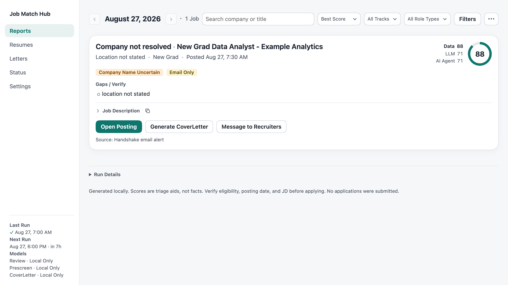
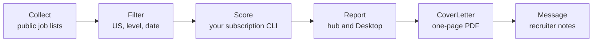

<div align="center">

# Daily Job Match Alert

Every evening it finds new internship and new-grad postings, scores them
against your resumes with the Claude or ChatGPT plan you already have, and
drafts cover letters, all on your Mac.

[](LICENSE)


</div>



## How It Works



## Quick Start

```bash
git clone <this repository's URL> && cd daily-job-match-alert
npm ci
npm run setup
npm run hub
zsh scripts/install-launchd.sh 18 0
```

`npm run setup` asks about you, your roles and your resumes, then writes
`config.json`. It never overwrites a file. `npm run doctor` checks the rest.

## Make It Yours

| What     | Where to change it                                  |
| -------- | --------------------------------------------------- |
| Resumes  | Hub → Resumes (one PDF per track)                   |
| Roles    | Hub → Settings → Pipeline → Role Scope              |
| Schedule | `zsh scripts/install-launchd.sh <hour> <minute>`    |

## What You Get

- A shortlist each evening, one card per match, scored per resume.
- A local hub to filter, read the full description, and browse past days.
- One-click cover letters as one-page PDFs, written from your playbook.
- Recruiter notes and follow-ups ready to paste.
- A self-contained HTML file and an XLSX on your Desktop.

## Privacy

- Runs on the Claude Code or Codex CLI you are signed in to; no API keys.
- Resumes, letters, reports and state stay on your Mac, outside Git.
- Never applies, never sends a message, never logs in to a job site.

## Docs

- [Pipeline](docs/pipeline.md): what one run does, and how it recovers
- [Sources](docs/sources.md): where postings come from, and what is skipped
- [Hub](docs/hub.md): the pages, the report view, the first-run steps
- [Cover Letters](docs/cover-letters.md): drafting, rules, storage
- [Message to Recruiters](docs/outreach.md): the people panel
- [Configuration](docs/configuration.md): every key, engines, commands
- [Troubleshooting](docs/troubleshooting.md): `npm run doctor`, fixes
- [中文安装指南](SETUP.zh-CN.md) · [Verification](VERIFICATION.md)
- [Contributing](CONTRIBUTING.md) · [Security](SECURITY.md)
